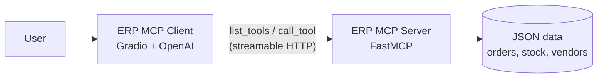

# ERP MCP Server

A [Model Context Protocol](https://modelcontextprotocol.io) server that exposes ERP data (sales orders, inventory and vendors) as tools any MCP-compatible client or AI agent can discover and call. Built with FastMCP and served over streamable HTTP.

> **Pairs with [ERP MCP Client](https://github.com/mulangph/AI_MCP_Client)**, a Gradio chatbot that uses these tools to answer business questions in plain language.

## How it fits together



The client asks the server which tools exist, hands them to the LLM, and runs whichever tools the model chooses. The server never talks to the LLM directly, so any MCP client (Claude Desktop, MCP Inspector, your own agent) can use it.

## Tools

| Tool | Input | Returns |
|---|---|---|
| `get_sales_order` | `order_id` (e.g. `12345`) | Customer, status, date, currency, total, line items |
| `get_stock` | `product_id` (e.g. `501`) | On-hand / reserved / available quantity, warehouse, reorder status |
| `get_vendor` | `vendor_id` (e.g. `2001`) | Status, contact, payment terms, rating, supplied products |
| `get_vendors_information` | none | All vendors |

Unknown IDs return a JSON error object such as `{"error": "Product not found", "product_id": 999}` so the model can explain the problem instead of failing.

## Quick start

Requires Python 3.12 and [uv](https://docs.astral.sh/uv/).

```bash
git clone https://github.com/mulangph/AI_MCP_Server.git
cd AI_MCP_Server
uv sync
uv run server.py
```

The server listens on **http://127.0.0.1:8000/mcp**. Leave it running, then start the [client](https://github.com/mulangph/AI_MCP_Client) in a second terminal.

To use a different host or port, set `MCP_HOST` and `MCP_PORT` before starting:

```bash
MCP_PORT=9000 uv run server.py
```

### Inspect the tools without a client

The MCP Inspector lets you browse and call tools in your browser:

```bash
uv run mcp dev server.py
```

## Sample data

The `data/` folder holds mock records you can query straight away:

| File | IDs |
|---|---|
| `orders.json` | 12345, 12346, 12347 |
| `stock_quant.json` | 501, 502, 503 |
| `vendors.json` | 2001, 2002, 2003 |

## Project structure

```
AI_MCP_Server/
├── server.py          # MCP tool definitions and entry point
├── data/              # Mock ERP records
├── pyproject.toml
└── uv.lock
```

## Roadmap

- [ ] Replace JSON files with a real ERP API (e.g. Odoo)
- [ ] Search tools (orders by customer, products by name)
- [ ] Authentication on the HTTP endpoint
- [ ] Tests for each tool

## License

MIT
